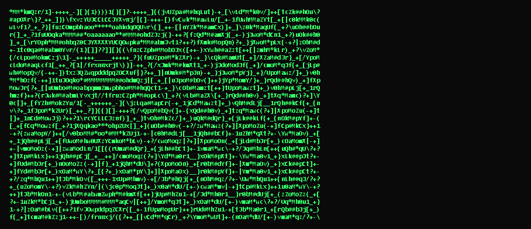

# ASCII Cam

> Your webcam feed rendered as **real-time ASCII art** — entirely in the browser.

<p align="center">
  
</p>

ASCII Cam turns your webcam into a retro terminal. Every frame is downsampled,
converted to luminance, and mapped onto a ramp of characters (` .:-=+*#%@` …)
so the picture appears as text — live, at interactive frame rates.

**100% client-side. No uploads, no server, no dependencies.** The camera stream
never leaves your machine.

---

## Features

- 📷 **Live webcam → ASCII** in real time via `getUserMedia` + `<canvas>`
- 🎛️ **Toggleable controls** — Color / B&W, Mirror, Invert
- 🧪 **Demo mode** — a generated animated pattern when you have no camera
- 🎨 **Color mode** — each character is tinted with the sampled pixel color
- 🖥️ **No build step** — one self-contained `index.html`, zero dependencies
- 📱 **Responsive** — the grid adapts to the window height
- 🔒 **Private by design** — frames are processed locally and never transmitted

---

## Quick start

### Just open it

Download or clone the repo and open `index.html` directly in a modern browser.

> Camera access requires a **secure context**. That means `https://`, `localhost`,
> or a `file://` page opened directly. Plain `http://` on a remote host will be
> blocked by the browser.

### Serve it locally

Any static server works, for example:

```bash
# Python 3
python -m http.server 8000

# Node
npx serve .
```

Then visit <http://localhost:8000>.

No camera? Click **Demo (no camera)** to see the renderer in action.

---

## Usage

| Control | What it does |
| --- | --- |
| **Start Camera** | Requests webcam access and begins rendering. |
| **Demo (no camera)** | Runs a generated animated pattern — no permissions needed. |
| **Color** | Toggles between colored characters and monochrome green (B/W). |
| **Mirror** | Flips the feed horizontally (on by default, like a mirror). |
| **Invert** | Inverts luminance — handy for dark backgrounds or negative looks. |

---

## How it works

1. The webcam frame is drawn into an offscreen `<canvas>` (and mirrored if enabled).
2. `getImageData` samples one pixel per character cell.
3. Each pixel's luminance is computed with `0.2126R + 0.7152G + 0.0722B`.
4. The luminance selects a character from a density ramp, and (in color mode)
   the character is tinted with the sampled color.
5. The resulting text is written to a `<pre>` element every animation frame.

The character ramp and grid dimensions are defined near the top of the script in
`index.html` (`CHARS`, `COLS`), so they're easy to tweak.

---

## Project structure

```
.
├── index.html          # the entire app (HTML + CSS + JS)
├── assets/
│   ├── favicon.svg     # site icon
│   ├── demo.gif        # animated README demo
│   └── preview.png     # static preview / social share image
├── .gitignore
├── LICENSE
└── README.md
```

---

## Deploy to GitHub Pages

1. Push this repo to GitHub.
2. Go to **Settings → Pages**.
3. Under **Build and deployment**, set **Source** to *Deploy from a branch*,
   pick the `main` branch and the `/ (root)` folder, then **Save**.
4. Your app will be live at `https://<your-username>.github.io/<repo-name>/`.

Because the app is served over `https://`, the camera works out of the box.

---

## Browser support

Works in current versions of Chrome, Edge, Firefox, and Safari. `getUserMedia`
requires a secure context, and the page must be served over `https://`,
`localhost`, or opened via `file://`.

---

## Contributing

Contributions are welcome. Open an issue to discuss a change, or fork the repo
and submit a pull request.

1. Fork the repository.
2. Create a branch: `git checkout -b feature/my-change`.
3. Commit your changes: `git commit -m "Add my change"`.
4. Push and open a Pull Request.

---

## License

Released under the [MIT License](LICENSE).
